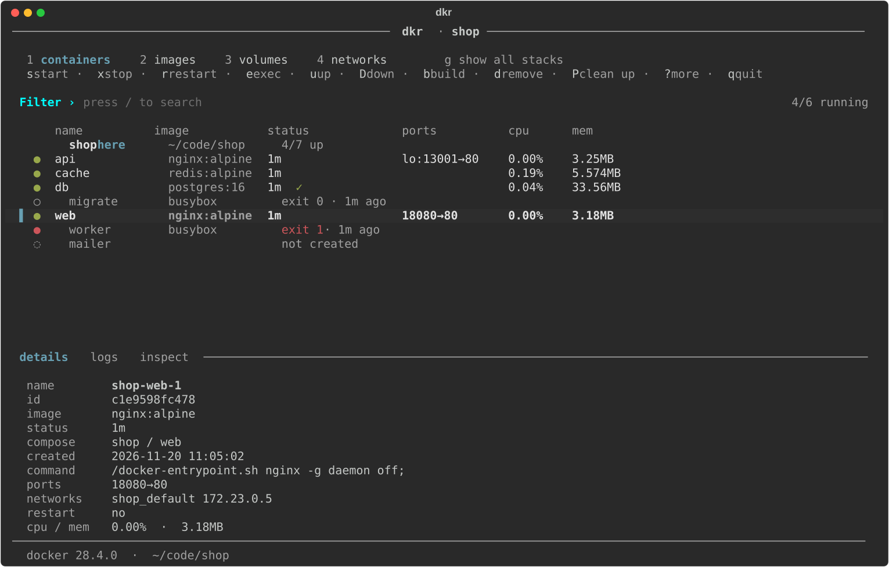
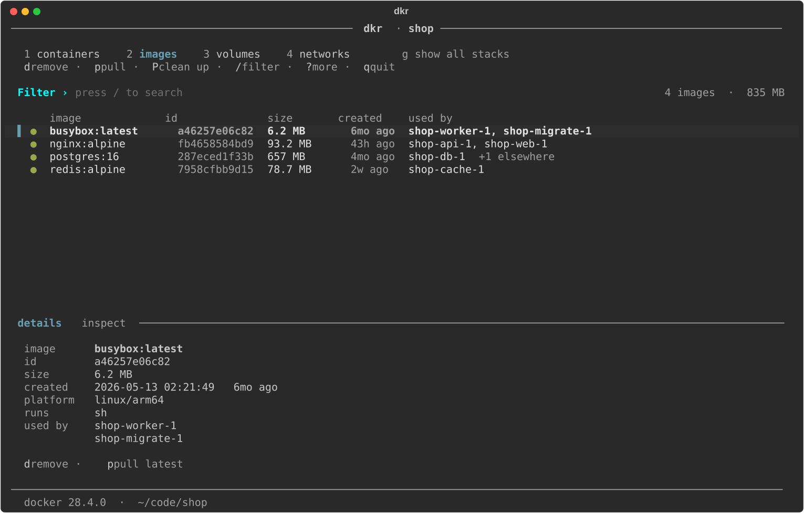

# dkr

**A calm, readable terminal dashboard for Docker, Podman and Docker Compose.**

`docker ps` wraps, repeats every port twice, and shows 40-character image names. `dkr` shows
the same information grouped by compose stack, with short images, `8080→80` ports and `7d ✓`
statuses — and lets you start, stop, exec, view logs, bring stacks up and down, browse images,
volumes and networks, and clean up disk space without leaving the keyboard.



## Features

- **Readable container list** — grouped by compose project, one accent colour, red/green only where it means something
- **Stack-aware** — run it inside a compose project and you see only that stack (press `g` for everything); services that haven't been created yet are listed too
- **Live details** — logs, a formatted summary (ports, mounts, networks, health) and raw inspect output for whatever's selected
- **One-key actions** — start / stop / restart / exec / remove, plus `compose up`, `down`, `build` and `pull` for any stack from anywhere
- **Images, volumes, networks** — sizes, age, and which containers use each one
- **Explained clean-up** — `P` shows what each prune option removes, how much space it frees and what it costs you, before running anything
- **CPU / memory** per container
- **Podman** support (auto-detected)
- **Single file**, no install step beyond [uv](https://docs.astral.sh/uv/)



## Install

Requires Docker (or Podman) and [uv](https://docs.astral.sh/uv/getting-started/installation/).
`dkr` is a single Python script; uv fetches its dependencies ([Textual](https://textual.textualize.io/)
and [Rich](https://rich.readthedocs.io/)) automatically on first run.

```bash
git clone https://github.com/adamredfern92/dkr.git
ln -sf "$PWD/dkr/dkr" ~/.local/bin/dkr   # any directory on your PATH works
```

Or grab just the script:

```bash
curl -fsSL https://raw.githubusercontent.com/adamredfern92/dkr/main/dkr -o ~/.local/bin/dkr && chmod +x ~/.local/bin/dkr
```

## Usage

```bash
dkr            # full-screen dashboard
dkr ps         # print running containers, grouped and readable, then exit
dkr ps -a      # ...including stopped / not-yet-created services
dkr ps -g      # ...for every stack, not just the one you're in
dkr prune      # open the clean-up screen directly
dkr logs -f    # anything else passes through to `docker compose` (in a compose project) or `docker`
```

### Keys

| Key | Action |
|---|---|
| `1` `2` `3` `4` | containers / images / volumes / networks |
| `g` | this stack ↔ all stacks |
| `s` `x` `r` | start / stop / restart — on a project header row, the whole project |
| `e` | shell into the container (bash, falls back to sh) |
| `d` | remove the selected container / image / volume / network (asks first; refuses if in use) |
| `P` | clean up disk space |
| `u` / `D` | `compose up -d` / `compose down` (asks first) for the selected or current stack |
| `U` | `compose up -d <service>` for the selected service |
| `b` / `p` | `compose build` / `pull` — in the images view, `p` pulls the selected image |
| `tab` | cycle details / logs / inspect |
| `z` | zoom the bottom pane (`esc` to return) |
| `/` | filter (`esc` clears) |
| `a` / `t` | show / hide stopped containers · toggle CPU and memory stats |
| `ctrl+p` | command palette — every action, searchable |
| `?` | show more keys · `q` quit |

Exec, up, down, build and pull hand the terminal over to the real command so you see its normal
output and progress; dkr comes back when it finishes.

### Clean up

`P` measures what can be freed and lists each option with what it removes, how much space, and
example names. Safe options — stopped containers, dangling images, unused networks, build cache —
are pre-selected. **All unused images** (they'll be pulled again when needed) and **unused
volumes** (deletes the data in them) are opt-in. Enter shows the exact commands and asks before
running them.

## Configuration

| Variable | Effect |
|---|---|
| `DKR_ENGINE=podman` | use podman even if docker is installed |

Podman support is best-effort and less tested than Docker; issues and PRs welcome.

## Development

```bash
uv run --with pytest --with textual --with rich pytest   # tests
uvx ruff check                                           # lint
```

The script is organised top to bottom as: engine calls (plain functions that shell out to
`docker` / `podman`), formatting, the row model shared by `dkr ps` and the dashboard, then the
[Textual](https://textual.textualize.io/) app.

## License

[MIT](LICENSE)
